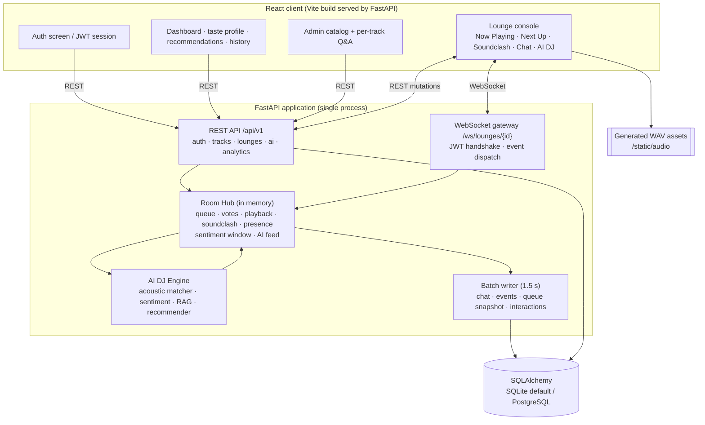

# Architecture Overview

This document reflects the system as built, not the reference design in the PRD. It extends
PRD Section 7.

---

## 1. Shape of the system



Five cooperating modules, mirroring the PRD layers:

| PRD layer | Implementation |
| --- | --- |
| Client | `frontend/src` — React console + dashboard |
| Application API | `backend/app/routers` |
| Queue & state gateway | `backend/app/realtime.py` (state) + `backend/app/ws.py` (transport) |
| AI DJ Engine | `backend/app/services/*` |
| Persistence | `backend/app/models.py`, `db.py`, `catalog.py` |

The AI engine has no dependency on the socket layer: `services/acoustic.py`, `sentiment.py` and
`recommend.py` are pure, and `rag.py` exposes async functions used by both HTTP and WebSocket paths.

---

## 2. Live room state

One `Room` object per active lounge is owned by the process (`Hub.rooms`). It holds:

- `QueueState` — ordered entries with per-user vote sets;
- current track, playback start timestamp, paused elapsed time;
- `SentimentWindow` and the last curation score;
- active Soundclash (candidates, votes, deadline, winner);
- connected sockets, participant metadata, typing indicators;
- the AI announcement feed and the recent-played list;
- dirty flags and pending chat/event/interaction buffers for batched writes.

### Atomic reordering

Every mutation runs under a per-room `asyncio.Lock`. A vote follows this sequence:

1. toggle the caller's vote in the entry's voter set (idempotent, reversible);
2. recompute ordering — descending votes, FIFO insertion as the stable tie-break;
3. assign sparse positions (`1000, 2000, …`);
4. broadcast **one** `lounge.queue.update` containing the complete queue, under the same lock.

No client can observe a partially reordered queue because a mutation never awaits mid-reorder and
the broadcast carries the whole list rather than a delta. A concurrent-vote test asserts that all
arrival orders converge on one deterministic final order.

### Playback clock

The server is the clock: `startedAt` (epoch ms) plus `serverTime` is enough for clients to render
progress without a 1 Hz tick. A 1-second server loop advances tracks when
`elapsed >= duration`; pause stores elapsed time and resume rebases `startedAt`. Clients splay the
audio element to the derived position and correct drift beyond 1.5 s.

### Presence and host continuity

Presence is derived from open sockets (unique users + per-user connection count). When the host's
last socket closes, the room deterministically:

1. promotes a connected **Co-DJ** to host (updates `users.role`, `dj_lounges.host_user_id`, live
   connection roles, and broadcasts the handover), or
2. sets `frozen = true` and rejects queue mutations until the host reconnects, which unfreezes it.

This is covered by an end-to-end test. Mid-session joins receive `lounge.state` (Now Playing, full
queue, active battle, participants, AI feed) plus the last 40 chat messages immediately.

### Batched persistence

The PRD explicitly warns against writing on every vote/sentiment tick. The hub buffers chat,
events, queue snapshots and listening interactions and flushes every 1.5 s (and on shutdown).
Full queue snapshots are rewritten in one transaction; sparse positions keep the model sensible and
would allow single-row reorders if the snapshot policy changed.

---

## 3. AI DJ Engine

### 3.1 Acoustic matching (hard constraints)

`services/acoustic.py`:

- **BPM**: candidate must fall within `tolerancePct` (default 8 %) of the current BPM, **or** within
  the same window of a half-time / double-time reference. Example: 120 BPM accepts 110.4–129.6,
  plus 55.2–64.8 and 220.8–259.2.
- **Key**: Camelot relation must be `identical`, `adjacent` (±1 number on the same letter, wrapping
  12↔1), or `relative` (same number, opposite letter). Anything else is a clash and cannot be an
  immediate segue.

Ranking among valid candidates follows the PRD weights exactly:

| Component | Weight | Detail |
| --- | --- | --- |
| Harmonic closeness | 50 % | identical 1.0 · relative 0.85 · adjacent 0.7 |
| Energy-curve fit | 30 % | `1 - |candidate.energy - target|`, target from sentiment |
| Recency | 20 % | linear decay for tracks in the last 10 played |

`target_energy_for_sentiment` maps the rolling score to `[0.15, 0.98]` so a hot room pulls energy up
and fatigue pulls it back.

### 3.2 Choosing the next track

When a track ends (or the host presses next):

1. The AI evaluates the queue's **hot zone** (first 4 entries by current vote order). This is how
   crowd votes influence curation without overriding the harmonic constraints.
2. If no hot-zone candidate is valid, the whole queue is evaluated.
3. If still none, the engine tries **autopilot** against the catalog for a valid segue.
4. If nothing valid exists, the top-voted queued track plays in **`queue-fallback` mode** and the
   announcement explicitly says there was no rule-compliant segue. Such a fallback is never labelled
   an AI selection, which is why "every AI-selected segue is compliant" remains strictly true.

The chosen entry is removed from Next Up, playback starts, and the AI emits a transition line.

### 3.3 Sentiment pipeline

- `score_message` = VADER compound + slang/emoji adjustment; emoji-only messages are scored from the
  emoji lexicon. Buckets: positive ≥ +0.15, negative ≤ −0.15.
- `SentimentWindow` keeps 120 s of samples with a 20 s half-life, so a deliberate burst moves the
  room score within one window. The score is broadcast on every chat message and every 3 s.
- When `|score - lastCurationScore| ≥ 0.35`, curation fires: the best rule-valid queue candidate for
  the new sentiment is promoted, and the AI DJ posts a "room check" line explaining the move.
  This makes sentiment influence queue order observable, not just displayed.

### 3.4 RAG grounding

Metadata is the authored `track_timeline_events` plus an acoustic-profile pseudo-entry. Retrieval is
keyword-overlap scoring with type hints (`sample`, `trivia`, `artist`, tempo terms). The answer is
built from the retrieved entry and the response carries:

```json
{
  "answer": "From the crate notes on …",
  "sourceEvents": ["evt_…"],
  "citations": [{ "eventId": "evt_…", "type": "sample_credit", "text": "…" }],
  "grounded": true
}
```

If retrieval finds nothing, `grounded` is `false`, `sourceEvents` is empty, and the DJ declines to
answer. When an LLM is configured, its output is accepted only if every number appears in the source
corpus and at least 45 % of its content tokens come from that corpus; otherwise the deterministic
composer is used. Transitions use the same guard and cite the incoming track's metadata.

### 3.5 Soundclash

Any listener can submit a track; the first submission auto-opens a 30 s battle if none is open
(2–4 candidates). Votes are one per user per battle, toggled. Resolution:

1. tally votes; unique leader wins;
2. ties break by the acoustic ranking against the current track (deterministic fallback: candidate
   id order);
3. remove any duplicate queue entry, splice the winner into the front of Next Up;
4. broadcast `resolved`, `queue.update`, `ai.dj_announcement` and the refreshed battle.

A background task closes the battle at its deadline; the host can resolve early.

---

## 4. Recommendation engine

`services/recommend.py` builds implicit feedback from `interactions`
(`completion + played ratio + like`), then:

- **Content similarity**: harmonic key, BPM proximity, energy, valence and genre family
  (weights 0.20 / 0.15 / 0.15 / 0.10 / 0.40 — selected on the holdout split);
- **Collaborative filtering**: item-item cosine over user–track weight vectors, added as a small
  rank bonus (0.01) because the seeded interaction set is intentionally small; it grows in influence
  as real co-listening data accumulates;
- **Cold start**: popularity + energy/valence heuristic so the rail is never empty.

Precision@5 on a reproducible random 5-item-per-user holdout is **0.60** (target 0.60). The model is
recomputed on request, so new interactions appear without a retrain/redeploy cycle.

---

## 5. Security model

- JWT HS256 access tokens (60 min) and refresh tokens (7 days); role claim is informational —
  every request re-loads the user and uses the current DB role.
- Four roles: `listener`, `co_dj`, `host`, `admin`. Admin-only catalog writes; host/co-DJ/admin
  lounge management; listeners can chat, vote, submit and ask.
- WebSocket handshake requires `?token=`; bad tokens close with 4401, ended rooms with 4410, bad
  invite/locked rooms with 4403, capacity with 4409. Room-sensitive actions are re-authorised per
  event (`lounge.queue.promote`, playback, battle control, settings).
- All chat/questions/timeline text is stripped of markup and control characters server-side, length
  limited, and rendered as text nodes in React.
- Secrets come from environment variables; `.env` is git-ignored and `.env.example` documents them.
- Track uploads validate BPM > 0, one of the 24 Camelot codes, and energy/valence in `[0,1]`.

A prototype trade-off: the WebSocket token travels in the query string (browsers cannot set headers
on `WebSocket`). A production build would use a short-lived, single-use ticket issued over HTTP.

---

## 6. Deviations and why

| PRD reference | Deviation | Reason |
| --- | --- | --- |
| Section 9.3 database | SQLite default instead of PostgreSQL | Keeps the reviewer setup to one command; SQLAlchemy models and `DATABASE_URL` support PostgreSQL. All queries are portable SQL. |
| Section 8 frontend | React + JavaScript with a hand-written CSS system (no UI kit) | Matches the Track A requirement without adding a second design dependency. |
| Section 6.2 AI text | Deterministic grounded composer by default, LLM optional | Guarantees repeatable, non-hallucinating output and an offline demo; hosted LLM is wired through an OpenAI-compatible endpoint when configured. |
| Section 9.4 positions | Sparse positions exist, but the whole queue is snapshot-rewritten per flush | Simpler and atomic at this scale; sparse encoding is still there for a future single-row reorder path. |
| Section 6.1 Soundclash persistence | Battle state is in memory only | The PRD treats high-frequency battle state as ephemeral; resolved battles are persisted for analytics. |
| Section 12 demo evidence | Scripted load/latency harness + automated WebSocket tests instead of screen recordings | Reproducible, reviewable evidence; the UI itself is fully interactive. |

---

## 7. Scaling path

The architecture does not hard-code a single room: `Hub` keys everything by `lounge_id`, and no
module assumes one socket. To run multiple API instances:

1. move room mutation events to Redis pub/sub (or NATS) and make the hub a per-room leader;
2. use sticky sessions or a ticket-based gateway for socket affinity;
3. move the batched writer onto a queue (or Postgres `COPY`/batch inserts);
4. swap SQLite for PostgreSQL and add a read replica for analytics;
5. keep the AI engine stateless and cache track profiles by version.
