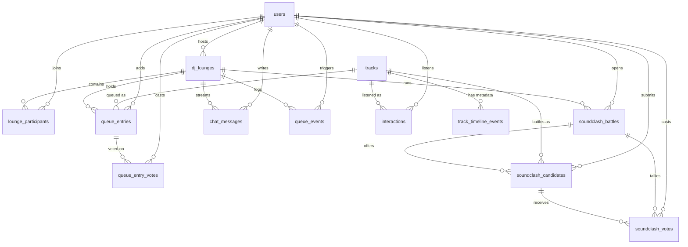

# Database

Shipped engine: SQLite (`backend/app.db`) with WAL enabled and foreign keys enforced, via
SQLAlchemy 2.x declarative models in [`backend/app/models.py`](backend/app/models.py). The schema is
plain relational SQL, so `DATABASE_URL=postgresql+psycopg://…` works without model changes.

Schema creation is automatic on startup (`Base.metadata.create_all`). There are no migrations yet —
this is a demo-scale schema, and Alembic is the first thing to add before production.

## What lives where

The split is deliberate: **realtime reads never touch the database**.

| State | Home | Why |
| --- | --- | --- |
| Queue order, votes, battle countdown, presence, sentiment window, playback clock | In-memory room hub (`app/realtime.py`) | Sub-100 ms fan-out; reads must not contend with disk |
| Chat messages, vote rows, battle results, event log, interactions | SQLite | Durability, analytics, recommendation training signal |
| Track metadata + acoustic features | SQLite, cached in process (`app/catalog.py`) | Read-mostly; validated on admin writes |

The hub snapshots its mutable rows to SQL every ~1.5 s and on end-of-session. A hard crash can lose
up to the last snapshot interval of votes and chat — accepted per PRD 9.4, and stated in the README.

## ER diagram



## Tables

### `users`

| Column | Type | Notes |
| --- | --- | --- |
| `id` | `String(32)` PK | `u_…` |
| `email` | `String(255)` unique, indexed | lower-cased on write |
| `display_name` | `String(80)` | shown in chat and presence |
| `password_hash` | `String(255)` | bcrypt, never selected into API responses |
| `role` | `String(16)` | `listener` \| `codj` \| `host` \| `admin` (global role) |
| `genre_affinity` | `JSON` | lightweight onboarding signal |
| `created_at` | `DateTime(tz)` | |

### `tracks` + `track_timeline_events`

| Column | Type | Notes |
| --- | --- | --- |
| `id` | `String(32)` PK | `t_…` |
| `title`, `artist` | `String(160)` | |
| `genre` | `String(60)` | drives genre-aware similarity |
| `duration_seconds` | `Integer` | 1–900 enforced in the API layer |
| `audio_asset_url` | `String(255)` | `/static/audio/<slug>.wav` |
| `bpm` | `Float`, indexed | > 0 |
| `camelot_key` | `String(3)`, indexed | one of the 24 codes `1A`–`12B` |
| `energy`, `valence` | `Float` | `[0,1]` |
| `created_at` | `DateTime(tz)` | |

`track_timeline_events` holds the grounding corpus for the AI: `id` (`evt_…`), `track_id`
(ON DELETE CASCADE, indexed), `ts_seconds`, `event_type` (seeded data uses `trivia` and
`sample_credit`; the column is free-form and the admin API accepts any short type string), and
`text`. These rows are the only source the RAG layer may cite.

### `dj_lounges`

| Column | Type | Notes |
| --- | --- | --- |
| `id` | `String(32)` PK | `lg_…` |
| `name` | `String(120)` | |
| `host_user_id` | FK `users.id` | transferable at runtime (handover) |
| `invite_code` | `String(12)` unique, indexed | `SP-…` |
| `vibe_profile` | `String(80)` | `Open Format`, `High-Energy EDM`, … |
| `current_track_id` | FK `tracks.id`, nullable | |
| `status` | `String(16)` | `scheduled` \| `live` \| `ended` |
| `bpm_tolerance_pct` | `Float` | default `8.0`, validated `0 < x ≤ 25` |
| `soundclash_enabled` | `Boolean` | |
| `ai_verbosity` | `String(16)` | `quiet` \| `normal` \| `chatty` |
| `max_participants` | `Integer` | default 50, validated 2–200 |
| `locked` | `Boolean` | invite-only while true |
| `peak_participants` | `Integer` | analytics high-water mark |
| `created_at`, `started_at`, `ended_at` | `DateTime(tz)` | |

### `lounge_participants`

`id` (`lp_…`), `lounge_id` (cascade, indexed), `user_id` (cascade, indexed), unique on
`(lounge_id, user_id)`, `role`
(`host` \| `codj` \| `listener` \| `admin` **within this room**), `joined_at`, `last_seen_at`.

Room role is per-lounge and independent of the account's global role; the hub authorises with the
room role and falls back to the global role for admins.

### `queue_entries` + `queue_entry_votes`

| Column | Type | Notes |
| --- | --- | --- |
| `id` | `String(32)` PK | `qe_…` |
| `lounge_id` | FK cascade, indexed | |
| `track_id` | FK `tracks.id` | |
| `position` | `Integer` | sparse ordering key, default 1000 |
| `vote_count` | `Integer` | denormalised tally, recomputed from votes |
| `added_by_user_id` | FK, nullable | null for AI-added tracks |
| `created_at` | `DateTime(tz)` | |

`queue_entry_votes` is `id` (`qv_…`), `entry_id` (cascade, indexed), `user_id`, `created_at`, with a
unique constraint on `(entry_id, user_id)`. One row per user per entry; the API toggles by
delete/insert, and `vote_count` is reconciled from this table so a double vote cannot double-count.

Ordering is `vote_count DESC`, then insertion order (`added_seq` in memory, `position` on disk).
`position` is sparse (step 1000) and recomputed on every reorder, so a reorder is one cheap update
rather than a cascade of shifts. Two clients receiving the same snapshot always render the same order.

### `soundclash_battles` / `soundclash_candidates` / `soundclash_votes`

- `soundclash_battles`: `id` (`sc_…`), `lounge_id` (cascade, indexed), `opened_at`, `closes_at`,
  `status` (`open` \| `resolved` \| `cancelled`), `winning_track_id`, `opened_by_user_id`.
- `soundclash_candidates`: `id` (`scc_…`), `battle_id` (cascade, indexed), `track_id`,
  `submitted_by_user_id`, `vote_count`, `created_at`; unique per `(battle_id, track_id)`.
- `soundclash_votes`: `id` (`scv_…`), `battle_id`, `candidate_id` (cascade), `user_id`,
  `created_at`; unique per `(battle_id, user_id)` — one vote per person per battle, switching
  candidates replaces the previous row rather than stacking votes.

Ties are broken by acoustic fit to the track currently playing, then by earliest submission, so a
resolution is always deterministic.

### `chat_messages`

| Column | Type | Notes |
| --- | --- | --- |
| `id` | `String(32)` PK | `m_…` |
| `lounge_id` | FK cascade, indexed | |
| `user_id` | FK, nullable | null for system/AI messages |
| `msg_type` | `String(20)` | `chat` \| `ai_answer` \| `system` \| `dj_announcement` |
| `body` | `Text` | sanitised, max 500 chars |
| `sentiment_score` | `Float`, nullable | only `chat` rows are scored |
| `sentiment_bucket` | `String(12)` | `positive` \| `neutral` \| `negative` |
| `ts_seconds` | `Integer` | playback offset when sent |
| `reactions` | `JSON` | `{ "🔥": ["u_…"], … }` |
| `created_at` | `DateTime(tz)`, indexed | history pagination key |

Reading history joins `users` for `displayName`, so persisted and live payloads have the same shape.

### `queue_events`

Append-only audit log: `id` (`evt_…`), `lounge_id` (cascade, indexed), `user_id`, `type`,
`payload` (JSON), `ts` (epoch ms), `created_at` (indexed).

Emitted types: `queueAdd`, `vote`, `reorder` (with `reason` = `host_promote`, `host_remove` or
`ai_curate`), `promote`, `segue`, `aiSegue`, `aiSegueRequest`, `playback`, `battleOpened`,
`battleSubmit`, `battleVote`, `battleResolved`, `sentimentCuration`, `aiQuestion`, `chat`,
`settings`, `roleUpdate`, `loungeEnded`. The `type` column is a string, so adding a new event does not
need a migration.

Session analytics are derived from this log plus `chat_messages`, which is why the numbers on the
analytics page reconcile with the transcript instead of drifting.

### `interactions`

The recommendation signal: `id` (`ix_…`), `user_id` (cascade, indexed), `track_id` (cascade,
indexed), `lounge_id` (nullable), `played_seconds`, `completed`, `liked`,
`co_listened_with` (JSON list of user ids that heard it in the same room), `created_at` (indexed).

`co_listened_with` is what makes the collaborative-filtering component possible: it records who was
in the room, not just who pressed play.

## Indexes and why

| Index | Serves |
| --- | --- |
| `users.email` (unique) | login |
| `tracks.bpm`, `tracks.camelot_key` | candidate pre-filter before rule evaluation |
| `dj_lounges.invite_code` (unique) | join by code |
| `lounge_participants.(lounge_id)`, `(user_id)` | room membership checks on every request |
| `queue_entries.lounge_id` | snapshot reads and snapshots to disk |
| `queue_entry_votes.entry_id` | vote reconciliation |
| `soundclash_*.(battle_id)` | battle state assembly |
| `chat_messages.(lounge_id, created_at)` | history pagination and sentiment hydration |
| `queue_events.(lounge_id, created_at)` | analytics and replay |
| `interactions.(user_id, created_at)` | taste profile and holdout evaluation |

## Data lifecycle

1. **Seed** — `backend/scripts/seed_data.py` creates 6 accounts, 16 tracks with timeline metadata,
   102 interactions and a demo lounge (`--reset` drops all tables first).
2. **Session** — the hub mutates memory, appends to `chat_messages` / `queue_events`, and snapshots
   queue rows periodically.
3. **End** — `POST /lounges/{id}/end` flushes the final snapshot, sets `status='ended'` and
   `ended_at`. Rows are retained for analytics; nothing is deleted implicitly.
4. **Retention** — no TTL job ships with the demo. A production deployment would partition
   `queue_events` and `chat_messages` by month and drop beyond the retention window.

## SQLite specifics

```sql
PRAGMA journal_mode=WAL;   -- concurrent reads during writes
PRAGMA foreign_keys=ON;    -- cascades actually fire
```

`check_same_thread=False` is set because the engine is shared across the event loop's threadpool.
Writes are serialised by SQLite itself; that is the documented scaling ceiling, and the migration
path is async Postgres plus a queue for the append-only tables.

## Practical queries

```sql
-- Live queue order for a lounge
SELECT qe.position, t.title, qe.vote_count
FROM queue_entries qe JOIN tracks t ON t.id = qe.track_id
WHERE qe.lounge_id = 'lg_…'
ORDER BY qe.vote_count DESC, qe.position ASC;

-- Sentiment trend in 15-second buckets
SELECT created_at / 15 AS bucket, AVG(sentiment_score), COUNT(*)
FROM chat_messages
WHERE lounge_id = 'lg_…' AND msg_type = 'chat' AND sentiment_score IS NOT NULL
GROUP BY bucket ORDER BY bucket;

-- Co-listening pairs for the recommender
SELECT a.user_id, b.user_id, COUNT(*) AS shared
FROM interactions a JOIN interactions b
  ON a.lounge_id = b.lounge_id AND a.user_id < b.user_id AND a.track_id = b.track_id
GROUP BY a.user_id, b.user_id ORDER BY shared DESC;
```
